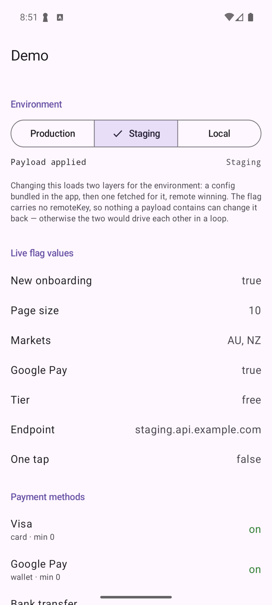
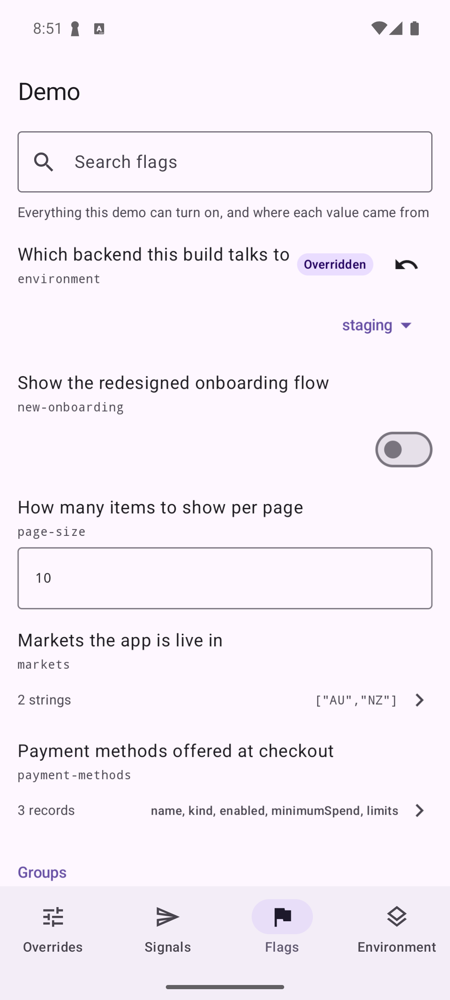

# Samples

Two Android apps: a host app that declares flags, and a companion app that edits them **without
linking a line of the host's code**. They talk through `featureflag-bridge`, a content provider in
the host that only apps signed with the host's key may open.

```sh
./gradlew :samples:host:installDebug :samples:companion:installDebug
```

Run **Demo** first, then **Flags**. Both debug builds are signed with the same committed key,
[`keys/shared-debug.keystore`](keys/README.md), so they work on any emulator or device with no
setup. Never use that key for anything real.

| Host app | Companion app |
|---|---|
|  |  |

The host shows live values and, underneath, which source supplied each one. The companion
renders the same flags from the published schema — a switch for the `Boolean`, a number field
for the `Int`, a picker for the enum, a URL field — and marks what has been overridden.

Set Google Pay in the companion and the host's "Where each value came from" says `Companion` for
`checkout.google-pay`, while a flag nobody has set says `default`. That line is
`pole.resolution(key, type)`, and it is the answer to "why is this flag false?".

## How the companion knows anything

It has never seen `AppFlags`. On every launch, in `Application.onCreate`, the host builds its pole
and publishes a schema describing its flag tree:

<!-- snippet: sample-host-wiring -->
```kotlin
val config = demoConfiguration()
// Highest first: a value set by hand in the companion beats the fetched remote config,
// which beats the bundled local one, which beats the compiled defaults.
val pole = FlagPole(
    AppFlagsSpec,
    sources = listOf(SharedPreferencesSource.companion(this)) + config.sources,
    applicationName = "Demo",
)
// The companion is a separate app and knows nothing of this flag tree until it is
// published. Do it on every launch, so a newly added flag shows up straight away.
pole.publishSchema(this)
model = DemoModel(pole, config, scope)
// One observer per enum: each `when` stays small and exhaustive, and every observer
// sees every signal rather than the first one claiming them all.
subscriptions = listOf(
    FlagSignalChannel.host.observe(AppSignal.entries) { signal -> model.handle(signal) },
    FlagSignalChannel.host.observe(CacheSignal.entries) { signal -> model.handle(signal) },
)
model.start()
```

which writes `flag-schema.json`:

<!-- snippet-ignore: abridged; the real file lists every flag -->
```json
{ "applicationName" : "Demo",
  "flags" : [ { "key" : "checkout.tier",
                "valueType" : "string",
                "defaultValue" : "free",
                "cases" : ["free", "pro", "enterprise"],
                "description" : "Which pricing tier to present" } ] }
```

The companion asks the host's bridge for that file and builds its editor from it. `cases` is why
the tier flag gets a picker instead of a text field. The companion knows one thing about the
host, its package name, and nothing about its flags.

## The environment flag drives the remote config

`AppFlags` has an `environment` flag — an ordinary enum, not a special type. Changing it applies
that environment's payload:

<!-- snippet: sample-host-environment -->
```kotlin
// The environment flag drives which payload is applied. flow() emits the current value
// first, so this also performs the initial load, and it never repeats a value.
scope.launch(start = CoroutineStart.UNDISPATCHED) {
    pole.flow(AppFlagsSpec.environment).collect { environment -> switchTo(environment) }
}
```

Two details carry the whole pattern.

**The environment flag has no `remoteKey`.**

<!-- snippet: sample-environment-flag -->
```kotlin
/**
 * Deliberately no remoteKey: this flag decides which payload gets fetched, so a payload must
 * not be able to decide it back.
 */
@Flag(description = "Which backend this build talks to")
val environment: DemoEnvironment get() = DemoEnvironment.Production
```

If it did, a staging payload could set the environment to production — which would mean a
different payload should have been fetched, and applying *that* could set it back. Nothing in the
library stops you wiring that loop; leaving the key off is what prevents it. A test asserts the
key stays absent, and another applies a payload that tries to set `environment` and checks it is
ignored.

**The old environment's values are cleared before the new ones are applied.** That leaves a brief
window on compiled defaults, which is deliberate: an app labelled *staging* still running
yesterday's production values looks fine and is wrong, which is worse than one running its own
defaults.

Overrides still outrank everything. Set Google Pay in the companion, then switch environment —
the override survives, and "Where each value came from" says `Companion`. Clear it and the
environment's value shows through.

## Rejecting a bad payload

One button applies a deliberately malformed payload: `onboarding.v2` sends `"yes"` where a boolean
belongs. It is rejected in full, and the valid `googlePay` beside it is not applied either.

`ScenarioTest`, in `host/src/test`, checks every payload against the real flag tree, because a
mistyped dot path fails silently as "the backend sent nothing" — the exact bug the demo exists to
make visible. The tests assert `absentKeys` is empty so a wrong path fails loudly.

## Signals: asking the host to do something

Flags let the companion change what the host *reads*. Signals let it ask the host to *act*. Both
apps depend on `:samples:signals`, so the two sides agree on every name:

<!-- snippet: sample-app-signal -->
```kotlin
/** Asks the host to redo or undo its remote configuration. */
public enum class AppSignal(override val signalDescription: String) : FlagSignal {
    RefetchRemoteConfiguration("Re-fetch remote configuration"),
    ClearRemoteConfiguration("Clear remote configuration"),
}
```

A signal travels as its entry name and carries no payload. The companion calls the host's bridge
provider; the host runs every matching observer on its main thread and answers whether one ran.

### Two groups, not one enum

The demo declares `AppSignal` for configuration and `CacheSignal` for caches, and the companion
files them:

<!-- snippet: sample-companion-tabs -->
```kotlin
FlagCompanion(
    hostPackage = BuildConfig.HOST_PACKAGE,
    tabs = listOf(
        // Overrides first: "what have I changed?" is the question you have before
        // filing a bug or handing the device to someone else.
        FlagCompanionTab.Overrides,
        // Two enums, two groups. The host observes each separately, so its
        // configuration handler never has to mention caches.
        FlagCompanionTab.Signals(
            FlagSignalGroup("Configuration", AppSignal.entries),
            FlagSignalGroup("Caches", CacheSignal.entries),
        ),
        FlagCompanionTab.Flags,
        // The environment flag earns a tab because changing it makes the host load
        // a different payload. Which key that is, is knowledge about this app.
        FlagCompanionTab.Detail(key = "environment", title = "Environment"),
    ),
)
```

The host observes each separately (the two `observe` calls in `onCreate` above), so its
configuration handler never has to mention caches, and each `when` stays exhaustive.

`CacheSignal.PurgeEverything` declares `requiresRestart`, because what it empties is rebuilt at
launch: the host handles it immediately and looks unchanged, so the companion reports "handled —
relaunch to see it" instead of leaving you to conclude nothing happened. Tap it and the host says
so too.

**A signal starts a host that is not running.** Here Android differs from iOS. The bridge is a
content provider, and Android starts a provider's process to answer a call, so a signal sent to a
closed host cold-starts it. `Application.onCreate` builds the pole, publishes the schema and
registers the observers, and only then does the provider answer. That is why all of it happens in
`onCreate`, and none of it later. The companion still waits for the host's answer, so a host with
no observer for that signal reads as "no response" rather than as success.

## Things to try

- **Put the two apps side by side in split screen and toggle a flag in the companion.** The host
  updates as you tap. The bridge writes the host's `SharedPreferences` file inside the host's own
  process, and `SharedPreferencesSource` hears every change. The companion re-reads whenever it
  comes back to the foreground.
- **Tap the reset arrow** next to an overridden flag. It falls back to the app's default and the
  badge disappears.
- **Add a payment method in the companion and leave its name blank.** The host lists it as
  "Untitled". The name is the record's key, so the companion refuses a second record with the
  same name: a list in which two records share a key cannot be read. If one arrived anyway, the
  host would read the compiled default list, while "Where each value came from" still said
  `Companion`.
- **Show QR code**, then paste the scanned string into another device's **Import…**. Only
  overrides travel, deflate-compressed. **Copy code** puts the same string on the clipboard.
- **Import something wrong** — paste `{"formatVersion":1,"values":{"nope":true}}`. It is rejected
  outright with a reason, rather than partly applied.
- **Watch the flow counter.** The bottom section counts `pole.flow(AppFlagsSpec.newOnboarding)` as
  changes arrive, whether from the companion app or a remote payload.
- **Close the host, then tap a signal** in the companion.
  `adb shell am kill com.andyyhope.featureflag.sample.host` stops it while it is in the
  background; the signal starts it again and still reports "handled".
- **Install the untrusted companion** with `./gradlew :samples:companion:installUntrusted`. It is
  the same app signed with [`keys/untrusted.keystore`](keys/README.md), installed beside the trusted
  one. It finds the host but cannot open it, and says so: the host only lets apps signed with its
  own key connect, followed by both certificates' SHA-256 digests.

## Files

| File | Module | Purpose |
|---|---|---|
| [`AppFlags.kt`](host/src/main/kotlin/com/andyyhope/featureflag/sample/host/AppFlags.kt) | host | The flag tree |
| [`DemoApplication.kt`](host/src/main/kotlin/com/andyyhope/featureflag/sample/host/DemoApplication.kt) | host | Builds the pole, publishes the schema and observes signals, in `onCreate` |
| [`DemoConfiguration.kt`](host/src/main/kotlin/com/andyyhope/featureflag/sample/host/DemoConfiguration.kt) | host | Defines `demoConfiguration()`, the environment configuration the app and the tests use |
| [`DemoModel.kt`](host/src/main/kotlin/com/andyyhope/featureflag/sample/host/DemoModel.kt) | host | Owns the environment configuration, the remote source it feeds, and the screen's state |
| [`DemoScreen.kt`](host/src/main/kotlin/com/andyyhope/featureflag/sample/host/DemoScreen.kt) | host | Live values, remote payloads, provenance, signals and the flow counter |
| [`DemoActivity.kt`](host/src/main/kotlin/com/andyyhope/featureflag/sample/host/DemoActivity.kt) | host | Shows the screen |
| [`RemoteConfiguration.kt`](host/src/main/kotlin/com/andyyhope/featureflag/sample/host/RemoteConfiguration.kt) | host | The bundled payloads, including two no dot path can read |
| [`LocalConfiguration.kt`](host/src/main/kotlin/com/andyyhope/featureflag/sample/host/LocalConfiguration.kt) | host | The config bundled for each environment |
| [`DemoRemoteMapper.kt`](host/src/main/kotlin/com/andyyhope/featureflag/sample/host/DemoRemoteMapper.kt) | host | A custom mapper, for the payload shaped as a list |
| [`AppSignals.kt`](signals/src/main/kotlin/com/andyyhope/featureflag/sample/signals/AppSignals.kt) | both | Two signal enums — one group each, shared so both sides agree |
| [`CompanionActivity.kt`](companion/src/main/kotlin/com/andyyhope/featureflag/sample/companion/CompanionActivity.kt) | companion | Chooses which tabs the companion shows |
| [`AndroidManifest.xml`](companion/src/main/AndroidManifest.xml) | companion | Asks for the host's bridge permission |
| [`keys/`](keys/README.md) | both | The two debug-only signing keys |

The host depends on `featureflag-bridge`, never on `featureflag-ui`, so no editor code ships in the
app people install:

<!-- snippet: sample-host-dependencies -->
```kotlin
// featureflag-bridge brings featureflag-android and featureflag-core with it.
implementation(project(":featureflag-bridge"))
implementation(project(":samples:signals"))
ksp(project(":featureflag-ksp"))
```

The companion depends on `featureflag-ui`:

<!-- snippet: sample-companion-dependencies -->
```kotlin
// featureflag-ui is the whole companion, and brings the bridge client (featureflag-android) with it.
implementation(project(":featureflag-ui"))
implementation(project(":samples:signals"))
```

Note how little the companion is. `CompanionActivity` is a list of tabs — overrides, signals,
flags, and the environment flag on a tab of its own — because connecting to the host, handling
every way that fails, and the overrides, flags and signals screens all come from `FlagCompanion`.
The environment tab is `FlagCompanionTab.Detail(key = "environment")`, not a screen the sample
draws. A companion with no signals and nothing bespoke needs only:

<!-- snippet-ignore: the default tabs, shown for contrast with CompanionActivity -->
```kotlin
FlagCompanion(hostPackage = "com.andyyhope.featureflag.sample.host")
```

Both apps build, and their tests run, in `./gradlew build`, so the samples cannot silently rot.

## Both apps must be signed with the same key

There is no App Group on Android. The host's bridge is guarded by a `signature` permission, which
Android grants only to apps signed with the host's own key. The companion asks for it by name:

<!-- snippet: sample-companion-uses-permission -->
```xml
<uses-permission android:name="${hostId}.permission.FEATURE_FLAG_BRIDGE" />
```

`${hostId}` is a manifest placeholder. The host's id is written once, in the root
`gradle.properties`:

```
featureflag.sample.hostId=com.andyyhope.featureflag.sample.host
```

and becomes the host's `applicationId`, this placeholder, and the companion's
`BuildConfig.HOST_PACKAGE`. The host has no `applicationIdSuffix` in any build type: a suffix
changes the bridge's authority and permission, and the companion would have to name the suffixed
id.

The companion's signing, with the untrusted build next to the trusted one:

<!-- snippet: sample-companion-signing -->
```kotlin
signingConfigs {
    // The key the host is signed with too, so Android grants the host's signature permission.
    getByName("debug") {
        storeFile = file("../keys/shared-debug.keystore")
        storePassword = "android"
        keyAlias = "sample"
        keyPassword = "android"
    }
    // Any other key: the host must refuse this build with PermissionDenied.
    create("untrusted") {
        storeFile = file("../keys/untrusted.keystore")
        storePassword = "android"
        keyAlias = "untrusted"
        keyPassword = "android"
    }
}
buildTypes {
    create("untrusted") {
        initWith(getByName("debug"))
        signingConfig = signingConfigs.getByName("untrusted")
        // Installs beside the trusted companion instead of replacing it.
        applicationIdSuffix = ".untrusted"
        // The library modules have only debug and release.
        matchingFallbacks.add("debug")
    }
}
```

For your own apps, sign the companion with the host's key or, on Android 12 and later, list the
companion's certificate in the host's `knownSigner` permission.

## When a payload has a shape no path can reach

Four of the demo's payloads are ordinary — every flag sits at a dot path, and `remoteKey` finds
it. Two are not:

<!-- snippet-ignore: abridged from RemoteConfiguration.kt -->
```json
{ "experiments": [ { "flag": "new-onboarding", "enabled": true } ] }
```

No path addresses "the record whose flag is new-onboarding", so `DotPathMapper` finds nothing and
the payload applies cleanly while changing absolutely nothing — which is the worst way for this to
fail. `DemoRemoteMapper` reshapes it, and composes the built-in mapper rather than replacing it, so
the older shape still works:

<!-- snippet: sample-remote-mapper -->
```kotlin
/**
 * Reads both shapes this backend has ever sent: the dot-path one, by composing DotPathMapper,
 * and a list of `{ "flag", "enabled" }` experiments that no dot path can reach.
 */
object DemoRemoteMapper : RemoteOverrideMapper {
    override fun map(payload: RemoteValue, schema: FlagSchema): Map<FlagKey, RemoteValue> {
        val records = payload.valueAt("experiments") as? RemoteValue.Array
            ?: return DotPathMapper.map(payload, schema)
        val result = LinkedHashMap<FlagKey, RemoteValue>()
        for (record in records.value) {
            val name = record.valueAt("flag") as? RemoteValue.String
            val enabled = record.valueAt("enabled") as? RemoteValue.Bool
            // Named by the key the schema publishes, so a typo here is reported as an unknown key.
            if (name != null && enabled != null) result[FlagKey(name.value)] = enabled
        }
        return result
    }
}
```

Tap **List of experiments, misspelled** to see the other half: a mapper is the only thing that can
emit a key no flag has, which is why that is reported as `UnknownKey` rather than skipped. Applying
is all-or-nothing, so the valid record beside it is not applied either.

## Adding remote overrides

`AppFlags` already declares remote keys. The library decodes; fetching is yours:

<!-- snippet-ignore: illustrative; fetch the bytes however your app does -->
```kotlin
val bytes = fetchConfig(configUrl)
config.remoteSource.apply(bytes)
```

against a payload shaped like:

<!-- snippet-ignore: abridged payload -->
```json
{ "featureToggles": { "onboarding": { "v2": true },
                      "checkout": { "googlePay": true } },
  "config": { "apiEndpoint": "https://staging.example.com" } }
```

The companion's overrides sit above remote in the stack, so anything set in the companion
survives the next fetch.
